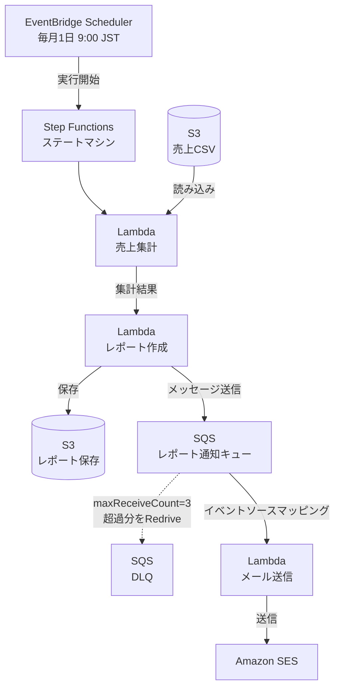
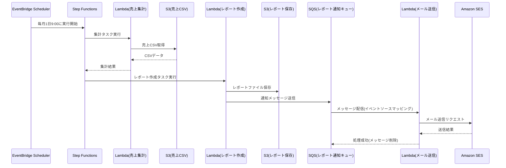
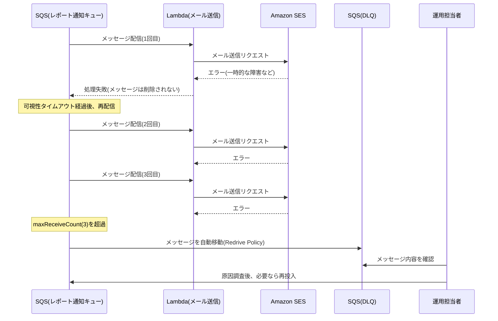

# 機能設計書 (Functional Design Document)

## システム構成図



**補足**: `SQS(DLQ)`への移動は、Lambda(メール送信)からの明示的な送信ではなく、「レポート通知キュー」側に設定するRedrive Policy(maxReceiveCount)によって、SQSサービス自身が自動的に行う。Lambdaの実行が失敗する(または正常終了しない)と、メッセージはキューに残り続け、可視性タイムアウト後に再配信される。これをmaxReceiveCount回繰り返しても失敗し続けた場合にDLQへ移動する。

## 技術スタック

| 分類 | 技術 | 選定理由 |
|------|------|----------|
| オーケストレーション | AWS Step Functions | 複数Lambdaを順序通り実行し、実行履歴・失敗箇所を可視化できる(要件3) |
| スケジューラ | Amazon EventBridge Scheduler | cron式で毎月1日9:00の定期実行を設定できる(要件2) |
| コンピュート | AWS Lambda(3関数) | サーバー管理不要で、集計・レポート作成・メール送信のそれぞれを疎結合な単位で実装できる |
| ストレージ | Amazon S3(2バケット) | 売上CSVの置き場、レポート成果物の置き場として利用(要件1、要件5) |
| メッセージング | Amazon SQS(メイン+DLQ) | レポート作成とメール送信を非同期・疎結合にし、失敗時の退避先を持つ(要件6、要件8) |
| メール配信 | Amazon SES | AWSネイティブなメール配信サービス。Lambdaから直接呼び出せる(要件7) |
| 構築方法 | AWSマネジメントコンソール(手動) | 学習目的のため、コンソール操作で各設定項目を確認しながら構築する |

## データモデル定義

### 売上CSV(S3: 売上CSVバケット)

```
date,product_id,product_name,category,quantity,unit_price,total_price
2024-01-01,P001,ノートPC,電子機器,5,80000,400000
2024-01-01,P002,マウス,電子機器,20,2000,40000
2024-01-01,P003,デスク,家具,3,25000,75000
```

| 列 | 内容 | 集計での用途 |
|---|---|---|
| `date` | 売上日(YYYY-MM-DD) | 日別合計の集計キー |
| `product_id` / `product_name` | 商品ID / 商品名 | 今回の集計では未使用(将来の商品別集計用に保持) |
| `category` | 商品カテゴリ | カテゴリ別合計の集計キー |
| `quantity` / `unit_price` | 数量 / 単価 | 今回の集計では未使用(`total_price`を直接使用) |
| `total_price` | 金額(quantity × unit_price) | 集計対象の金額 |

### 集計結果(Lambda集計 → Lambdaレポート作成 の受け渡し)

Step Functionsのステート間で受け渡すJSON。

```json
{
  "aggregationPeriod": "2024-01",
  "totalSales": 515000,
  "byCategory": [
    { "category": "電子機器", "totalSales": 440000 },
    { "category": "家具", "totalSales": 75000 }
  ],
  "byDate": [
    { "date": "2024-01-01", "totalSales": 515000 }
  ],
  "sourceCsvKey": "sales/sales_202401.csv"
}
```

**S3キーのプレフィックス方針**: 売上CSVは`sales/`というプレフィックス配下に置く(例: `sales/sales_202401.csv`)。バケット直下に置かず1階層のプレフィックスを設ける理由は、将来同じバケットに別種のファイルを置く場合でもIAMポリシーのリソース指定(`arn:aws:s3:::<bucket>/sales/*`)で権限を絞り込めるようにするため。

### レポート通知メッセージ(Lambdaレポート作成 → SQS → Lambdaメール送信)

SQSに送信するメッセージの構造。この設計がレポート作成とメール送信を疎結合にする要(かなめ)になる。

```json
{
  "reportBucket": "report-storage-bucket",
  "reportKey": "reports/2025-09-sales-report.csv",
  "reportSummary": "2025年9月の売上合計は¥xxx,xxxでした。詳細は添付レポートをご確認ください。",
  "generatedAt": "2025-10-01T00:05:00+09:00"
}
```

**設計判断: メール宛先はメッセージに含めない**
要件7で「宛先が設定で変更可能であること」が求められているが、宛先はLambda(メール送信)側の環境変数(例: `RECIPIENT_EMAILS`)で管理する。理由:
- メッセージ送信元(レポート作成関数)が宛先の情報を知る必要がなく、責務が分離される
- 宛先を変更したい場合、Lambdaの環境変数を書き換えるだけで済み、レポート作成関数を変更する必要がない

## コンポーネント設計

### Lambda: 売上集計(SalesAggregatorFunction)

**責務**:
- S3(売上CSV)から対象月のCSVファイルを読み込む
- 定義された集計ロジックに従って集計する
- 集計結果をStep Functionsの次ステート(レポート作成)へ渡す

**トリガー**: Step Functions(ステートマシン内の最初のタスク)

**主な設定項目**:
- 実行ロール: 対象S3バケットへの`GetObject`権限のみ付与(最小権限)
- タイムアウト: CSVサイズに応じて調整(初期値は数十秒〜1分程度を想定)

### Lambda: レポート作成(ReportGeneratorFunction)

**責務**:
- 集計結果からレポートファイル(CSV)を生成する
- 生成したレポートをS3(レポート保存)に保存する
- レポート概要を含むメッセージをSQS(レポート通知キュー)に送信する

**トリガー**: Step Functions(集計の後続タスク)

**主な設定項目**:
- 実行ロール: レポート保存用S3バケットへの`PutObject`権限、レポート通知キューへの`SendMessage`権限

### Lambda: メール送信(EmailSenderFunction)

**責務**:
- SQS(レポート通知キュー)からメッセージを受け取る
- メッセージに含まれるレポート概要をもとにメール本文を組み立てる
- Amazon SESでメールを送信する

**トリガー**: SQS(レポート通知キュー)からのイベントソースマッピング

**主な設定項目**:
- 環境変数: `SENDER_EMAIL`(検証済み送信元)、`RECIPIENT_EMAILS`(検証済み宛先、カンマ区切りなどで複数対応)
- 実行ロール: `ses:SendEmail`権限
- バッチサイズ: 1(メッセージ1件ずつ確実に処理する。複数件まとめて失敗した場合の切り分けを避けるため)

## ユースケース図

### 正常フロー: 月次レポートの自動生成・配信



### 異常フロー: メール送信失敗時のリトライとDLQ退避



## エラーハンドリング

| エラー種別 | 処理 | 検知・対応方法 |
|-----------|------|----------------|
| S3に売上CSVが存在しない/読み込み失敗 | Lambda(売上集計)が失敗し、Step Functionsのステート実行がエラーで終了する | Step Functionsの実行履歴(コンソール)で失敗を確認し、CSVを配置してから再実行する |
| 集計ロジックでのデータ不整合 | Lambda(売上集計)が失敗する | 同上。CloudWatch Logsでエラー内容を確認する |
| レポート作成・S3保存の失敗 | Lambda(レポート作成)が失敗し、Step Functionsのステート実行がエラーで終了する | Step Functionsの実行履歴で確認し、原因調査後に再実行する |
| メール送信の失敗(SESの一時エラーなど) | SQSのRedrive Policyにより最大3回まで自動リトライ | CloudWatchでキューの`ApproximateNumberOfMessagesVisible`等を監視(MVPでは手動確認) |
| リトライ上限(3回)超過 | メッセージがDLQへ自動移動し、保持され続ける | 運用担当者がDLQの内容を確認し、原因調査後に元のキューへ再投入するなどして再処理する |

## テスト戦略(動作確認方針)

このプロジェクトはAWSコンソールでの手動構築のため、自動テストではなく手動での動作確認を行う。

### 単体確認(各Lambda単位)
- 各Lambda関数をコンソールの「テスト」機能でテストイベントを使い個別実行し、想定通りの入出力になるか確認する

### 結合確認(一連のワークフロー)
- テスト用の売上CSVをS3(売上CSV)に配置し、Step Functionsを手動実行(Start Execution)して、集計→レポート作成→S3保存→SQS送信→メール受信まで一気通貫で確認する

### 異常系確認
- 存在しない/未検証のメールアドレスを一時的に設定するなどしてLambda(メール送信)を意図的に失敗させ、3回リトライ後にDLQへメッセージが移動することを確認する
- DLQに移動したメッセージを、元のキューへ再投入して正常に再処理できることを確認する
